# Fretprint

Turns a photo of a guitar scale chart (12 positions on one page) into a clean, colour-coded A4 chart ready to print. It can also generate a chart for any supported scale without a photo.

## Before and after

| Before: faded, low-resolution photo | After: generated A4 chart |
| :---: | :---: |
| 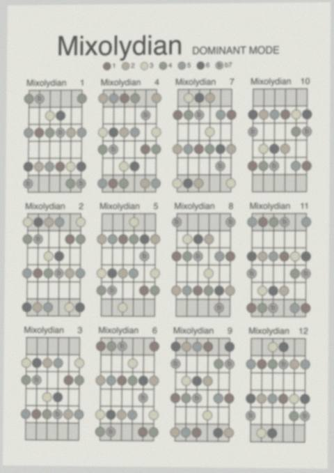 | 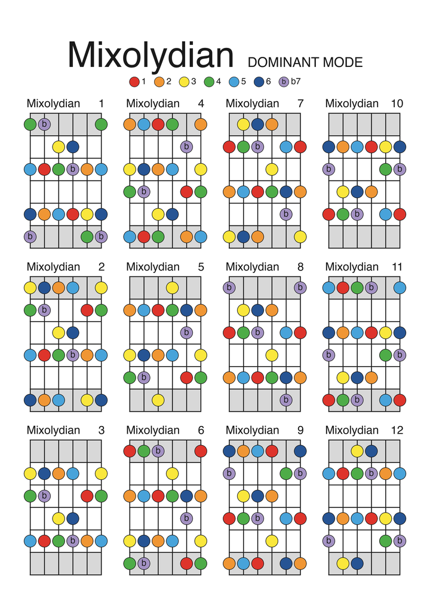 |

The photo is read dot for dot, the scale is recognised as Mixolydian, and the chart is redrawn with a colour per scale degree. The "before" image is a simulated photo: a generated chart with washed-out colours, blur, noise and a slight perspective tilt.

## Running it

macOS: double-click `start.command`. The first run installs the dependencies, then the browser opens at `http://127.0.0.1:5050/`.

Manually:

```bash
python3 -m venv .venv
.venv/bin/pip install -r requirements.txt
.venv/bin/python app.py
```

Environment variables: `PORT` (default 5050), `OPEN_BROWSER=0` disables opening the browser automatically.

The interface is in Polish.

## How it works

1. Upload a photo of the whole page with 12 diagrams (PNG, JPG, HEIC).
2. The app finds the 12 grids, reads the dots and recognises the scale from the title (OCR), the dot layout and the colours.
3. Pick the scale for the output chart: the one from the photo or any other.
4. Download a PNG or PDF in A4 at 300 dpi. "Wszystkie skale (ZIP)" downloads every scale at once.

To regenerate the charts in `wykresy/` without starting the server:

```bash
.venv/bin/python generate_all.py wykresy
```

## Charts

All eleven charts are in [`wykresy/`](wykresy) as A4 PNG and PDF, ready to print. Click a chart for the full-size image.

<table>
<tr>
<td align="center"><a href="wykresy/ionian-12-pozycji-A4.png">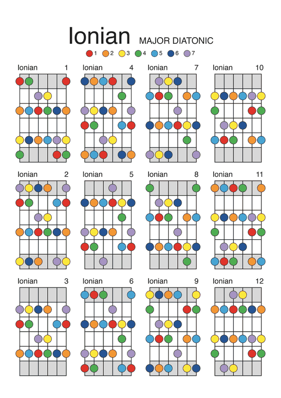</a><br><b>Ionian</b><br><code>1 2 3 4 5 6 7</code><br><a href="wykresy/ionian-12-pozycji-A4.png">PNG</a> · <a href="wykresy/ionian-12-pozycji-A4.pdf">PDF</a></td>
<td align="center"><a href="wykresy/dorian-12-pozycji-A4.png">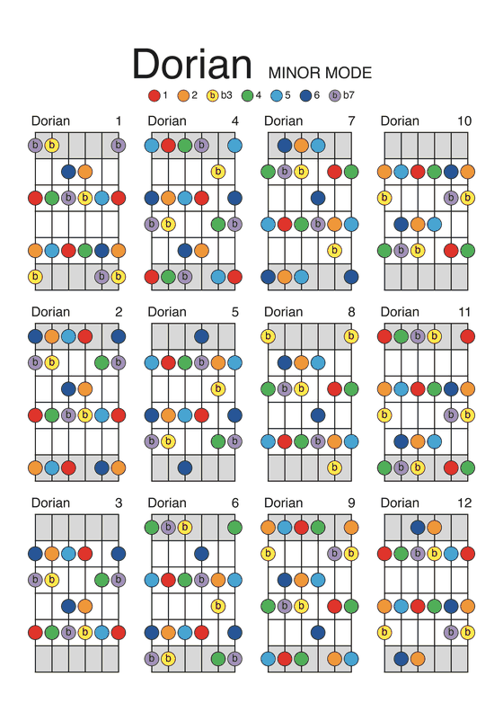</a><br><b>Dorian</b><br><code>1 2 b3 4 5 6 b7</code><br><a href="wykresy/dorian-12-pozycji-A4.png">PNG</a> · <a href="wykresy/dorian-12-pozycji-A4.pdf">PDF</a></td>
<td align="center"><a href="wykresy/phrygian-12-pozycji-A4.png">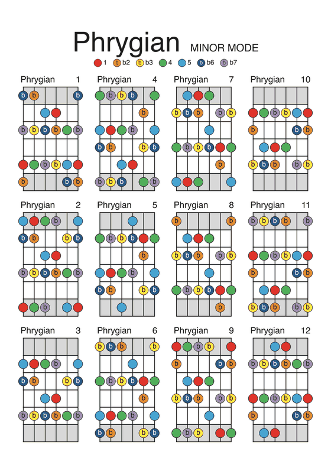</a><br><b>Phrygian</b><br><code>1 b2 b3 4 5 b6 b7</code><br><a href="wykresy/phrygian-12-pozycji-A4.png">PNG</a> · <a href="wykresy/phrygian-12-pozycji-A4.pdf">PDF</a></td>
</tr>
<tr>
<td align="center"><a href="wykresy/lydian-12-pozycji-A4.png">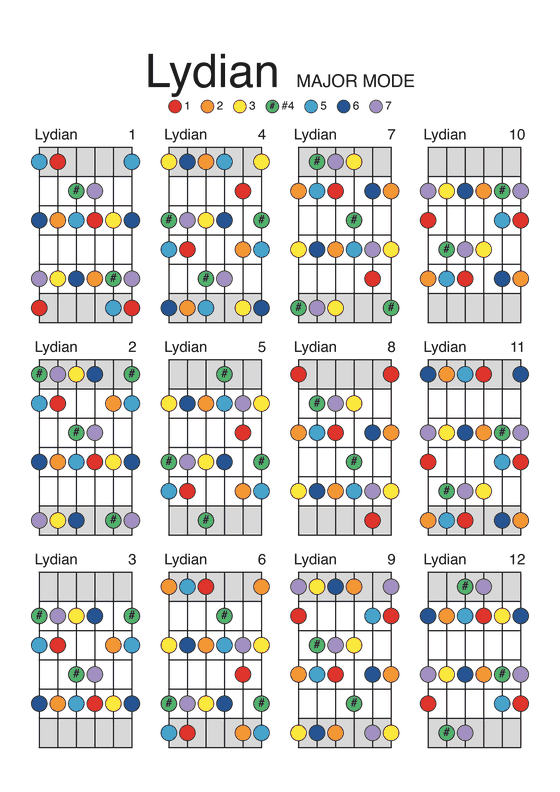</a><br><b>Lydian</b><br><code>1 2 3 #4 5 6 7</code><br><a href="wykresy/lydian-12-pozycji-A4.png">PNG</a> · <a href="wykresy/lydian-12-pozycji-A4.pdf">PDF</a></td>
<td align="center"><a href="wykresy/mixolydian-12-pozycji-A4.png"></a><br><b>Mixolydian</b><br><code>1 2 3 4 5 6 b7</code><br><a href="wykresy/mixolydian-12-pozycji-A4.png">PNG</a> · <a href="wykresy/mixolydian-12-pozycji-A4.pdf">PDF</a></td>
<td align="center"><a href="wykresy/aeolian-12-pozycji-A4.png">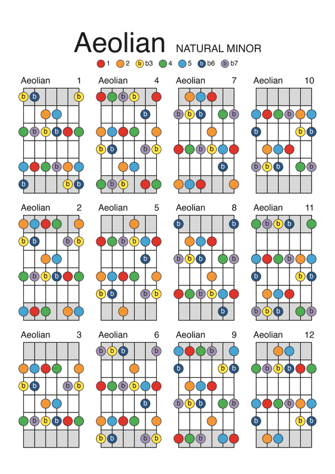</a><br><b>Aeolian</b><br><code>1 2 b3 4 5 b6 b7</code><br><a href="wykresy/aeolian-12-pozycji-A4.png">PNG</a> · <a href="wykresy/aeolian-12-pozycji-A4.pdf">PDF</a></td>
</tr>
<tr>
<td align="center"><a href="wykresy/locrian-12-pozycji-A4.png">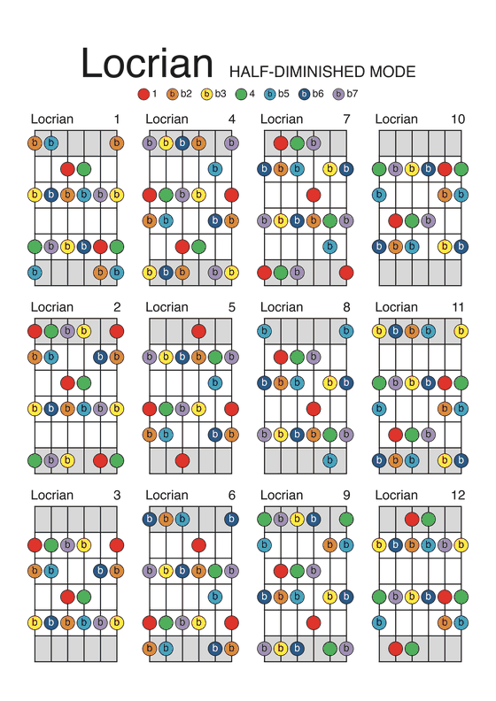</a><br><b>Locrian</b><br><code>1 b2 b3 4 b5 b6 b7</code><br><a href="wykresy/locrian-12-pozycji-A4.png">PNG</a> · <a href="wykresy/locrian-12-pozycji-A4.pdf">PDF</a></td>
<td align="center"><a href="wykresy/harmonic-minor-12-pozycji-A4.png">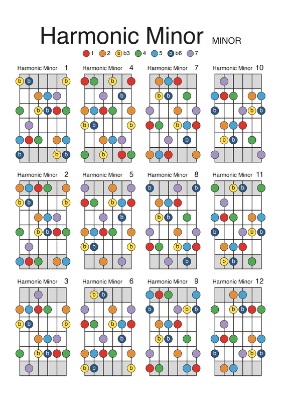</a><br><b>Harmonic Minor</b><br><code>1 2 b3 4 5 b6 7</code><br><a href="wykresy/harmonic-minor-12-pozycji-A4.png">PNG</a> · <a href="wykresy/harmonic-minor-12-pozycji-A4.pdf">PDF</a></td>
<td align="center"><a href="wykresy/major-pentatonic-12-pozycji-A4.png">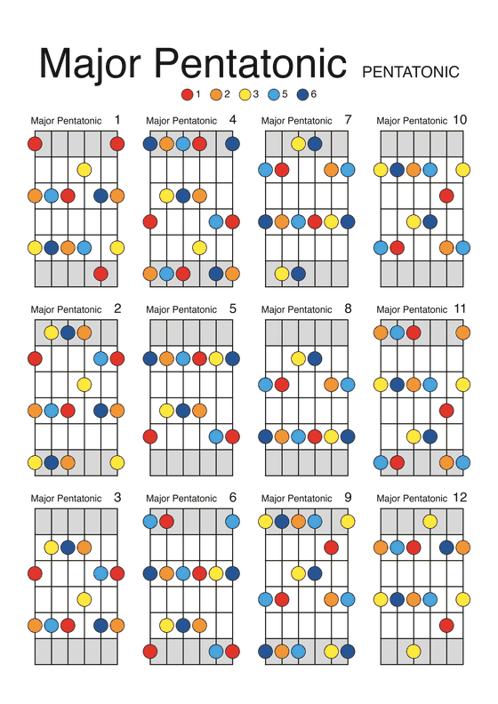</a><br><b>Major Pentatonic</b><br><code>1 2 3 5 6</code><br><a href="wykresy/major-pentatonic-12-pozycji-A4.png">PNG</a> · <a href="wykresy/major-pentatonic-12-pozycji-A4.pdf">PDF</a></td>
</tr>
<tr>
<td align="center"><a href="wykresy/minor-pentatonic-12-pozycji-A4.png">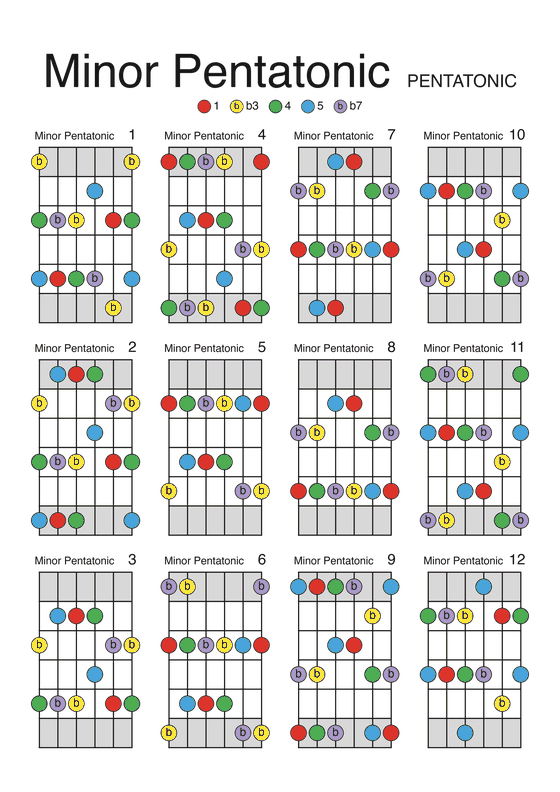</a><br><b>Minor Pentatonic</b><br><code>1 b3 4 5 b7</code><br><a href="wykresy/minor-pentatonic-12-pozycji-A4.png">PNG</a> · <a href="wykresy/minor-pentatonic-12-pozycji-A4.pdf">PDF</a></td>
<td align="center"><a href="wykresy/diminished-12-pozycji-A4.png">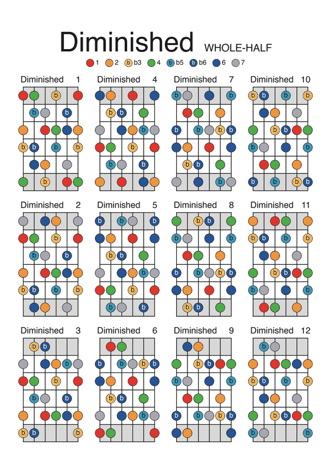</a><br><b>Diminished</b><br><code>1 2 b3 4 b5 b6 6 7</code><br><a href="wykresy/diminished-12-pozycji-A4.png">PNG</a> · <a href="wykresy/diminished-12-pozycji-A4.pdf">PDF</a></td>
</tr>
</table>

## Chart model

Every diagram shows the same six-fret window in a different key: position `n+1` is the same scale moved one fret down. Strings run left to right E A D G B e. The first and last rows (grey) are the frets next to the position; notes in those rows are left out when the same pitch already appears on a neighbouring string inside the white part of the diagram.

Colours mark scale degrees: 1 red, 2 orange, 3 yellow, 4 green, 5 light blue, 6 dark blue, 7 purple. A lowered or raised degree carries a `b` or `#` on its dot.

The modes of the major scale (Ionian, Dorian, Phrygian, Lydian, Mixolydian, Aeolian, Locrian) share identical shapes and differ only in which note is the first degree. Harmonic Minor and Minor Pentatonic use the Aeolian root; Major Pentatonic and Diminished use the Ionian root.

Scales are defined in `converter/scales.py`; adding a scale takes one entry in `SCALES`.

## Photo recognition limits

- The photo has to show the whole page: 4 columns of 3 diagrams, reasonably straight and filling the frame.
- A faded photo of a mode without a readable title cannot be assigned to one scale, because the shapes are shared; the scale is then picked from the list.
- A chart that matches no known scale can be reproduced dot for dot with the colours read from the photo.

## Tests

```bash
.venv/bin/python -m pytest
```
